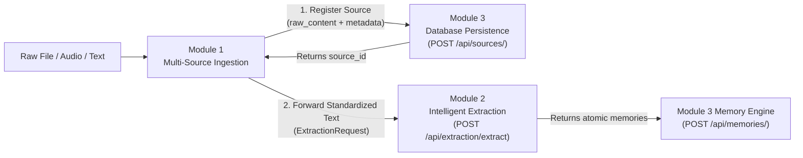

# AFTERMIND — Module 1: Multi-Source AI Data Ingestion

**Production-grade ingestion pipeline converting raw business documents, meeting recordings, voice notes, and transcripts into standardized, persistent business memories.**

Module 1 serves as the foundational data entry point for AFTERMIND. It ingests multi-modal business inputs, validates and cleans text, registers the source in **Module 3 (Persistence)**, and feeds standardized text to **Module 2 (Intelligent Memory Extraction)**.

---

## Architecture Overview

```text
backend/data_ingestion/
├── __init__.py                 # Package declaration and public exports
├── config.py                   # Ingestion settings, file size limits, provider selection
├── normalizer.py               # Text normalization, unicode cleaning, length validation
├── schemas.py                  # Pydantic v2 schemas and validation contracts
├── service.py                  # Ingestion orchestrator & team integration logic
├── routes.py                   # FastAPI endpoints under /api/ingest
├── README.md                   # Module documentation
├── parsers/                    # Specialized document format parsers
│   ├── __init__.py
│   ├── base.py                 # Abstract parser interface & DocumentParsingError
│   ├── text_parser.py          # .txt, .md, .csv, .json parser
│   ├── pdf_parser.py           # .pdf parser with built-in pure-Python stream fallback
│   ├── docx_parser.py          # .docx parser using built-in zipfile and ElementTree
│   └── dispatcher.py           # Format routing and file size validation
├── transcribers/               # Audio transcription engine
│   ├── __init__.py
│   ├── base.py                 # Abstract transcriber interface & AudioTranscriptionError
│   ├── whisper.py              # OpenAI Whisper API transcriber (via httpx)
│   ├── gemini.py               # Google Gemini audio transcriber (via httpx)
│   ├── mock.py                 # Deterministic offline/test transcriber
│   └── manager.py              # Multi-provider resolution & fallback manager
└── tests/                      # Automated test suite (38 tests)
    ├── __init__.py
    ├── test_normalizer.py      # Unicode, whitespace, and size constraint tests
    ├── test_parsers.py         # 6 format tests, empty, corrupted, and invalid files
    ├── test_audio.py           # Audio extension support, mock, and error tests
    ├── test_ingestion_service.py # Persistence in Module 3 & Module 2 dispatch tests
    └── test_routes.py          # FastAPI endpoint integration tests
```

---

## Supported Input Formats

### 1. Document Formats (6 Supported)
| Format | Extension | Capabilities & Extraction Logic |
|---|---|---|
| **Plain Text** | `.txt` | Multi-encoding support (UTF-8, Latin-1), whitespace collapsing, control character stripping. |
| **Markdown** | `.md` | Preserves headers, lists, and structured notes while stripping unprintable control symbols. |
| **PDF** | `.pdf` | Extracts text streams, decompresses `FlateDecode` filters, counts pages, handles metadata. |
| **Word Document** | `.docx` | Extracts `<w:p>` paragraphs and `<w:t>` runs from `word/document.xml` with zero binary dependencies. |
| **CSV Spreadsheet** | `.csv` | Converts tabular data into structured row records (`Col: Val; ...`) for downstream NLP. |
| **JSON Data** | `.json` | Parses structured logs, transcripts, and key-value trees into readable text. |

### 2. Audio & Voice Note Formats (6 Supported)
- **Supported extensions:** `.mp3`, `.wav`, `.m4a`, `.ogg`, `.webm`, `.flac`
- **Transcription providers:**
  - `openai_whisper` (via OpenAI Whisper API)
  - `gemini_audio` (via Google Gemini multimodal API)
  - `mock_transcriber` (zero-network deterministic test provider)

---

## Integration Pipeline (Module 1 $\to$ Module 3 $\to$ Module 2)



1. **Module 3 Contract:**
   Module 1 calls `memory_service.create_source` with `SourceCreate`:
   - `company_id`: Tenant UUID
   - `title`: Document or recording title
   - `source_type`: `meeting`, `voice_note`, `document`, `email`, or `chat`
   - `raw_content`: Cleaned, standardized text content
   - `meta_info`: Word count, character count, page count, audio duration, file type
   
2. **Module 2 Contract:**
   When `trigger_extraction=True`, Module 1 packages the data into `ExtractionRequest`:
   - `company_id`: Tenant UUID
   - `source_id`: The ID returned by Module 3
   - `extracted_text`: Normalized text (max 100,000 chars)
   - `filename`: Original file name
   - `source_type`: Source classification

---

## API Endpoints Reference

All endpoints are mounted under `/api/ingest`:

| Method | Endpoint | Description | Status Code |
|---|---|---|---|
| `POST` | `/api/ingest/text` | Direct ingestion of text transcripts, notes, and chat logs | `201 Created` |
| `POST` | `/api/ingest/document` | Multipart document upload (`.txt`, `.md`, `.pdf`, `.docx`, `.csv`, `.json`) | `201 Created` |
| `POST` | `/api/ingest/audio` | Multipart audio upload (`.mp3`, `.wav`, `.m4a`, `.ogg`, `.webm`, `.flac`) | `201 Created` |
| `POST` | `/api/ingest/pipeline` | Unified pipeline endpoint: Ingest $\to$ Save in Mod 3 $\to$ Extract in Mod 2 | `201 Created` |
| `GET` | `/api/ingest/health` | Capability check and supported file formats reporting | `200 OK` |

---

## Configuration & Environment Variables

Add to `backend/.env`:

```env
# Module 1 Audio Transcription Settings
AUDIO_TRANSCRIBER_PROVIDER=auto    # 'auto', 'whisper', 'gemini', or 'mock'
OPENAI_WHISPER_MODEL=whisper-1
GEMINI_AUDIO_MODEL=gemini-1.5-flash

# API Keys (optional if using mock or heuristic providers)
OPENAI_API_KEY=your_openai_key
GEMINI_API_KEY=your_gemini_key

# Size & Character Limits
MAX_DOCUMENT_SIZE_BYTES=26214400   # 25 MB
MAX_AUDIO_SIZE_BYTES=52428800      # 50 MB
MAX_TEXT_CHARACTERS=100000         # 100k chars
```

---

## Running Automated Tests

Run the complete Module 1 test suite from `backend/`:

```powershell
python -m pytest data_ingestion/tests -v
```

All 38 tests cover:
- Text normalizer: unicode normalization, control character stripping, excessive whitespace collapsing, length constraint verification.
- Document parsers: valid parsing for `.txt`, `.md`, `.csv`, `.json`, `.pdf`, and `.docx`.
- Error handling: empty files (0 bytes), corrupted PDF streams, corrupted DOCX archives, invalid JSON, unsupported file types, missing extensions.
- Audio transcribers: format compatibility across `.mp3`, `.wav`, `.m4a`, `.ogg`, `.webm`, `.flac`, mock transcriber deterministic behavior, empty audio error handling.
- Module 3 & Module 2 integration: source persistence in database, entity mapping, extraction dispatch, and tenant validation.
